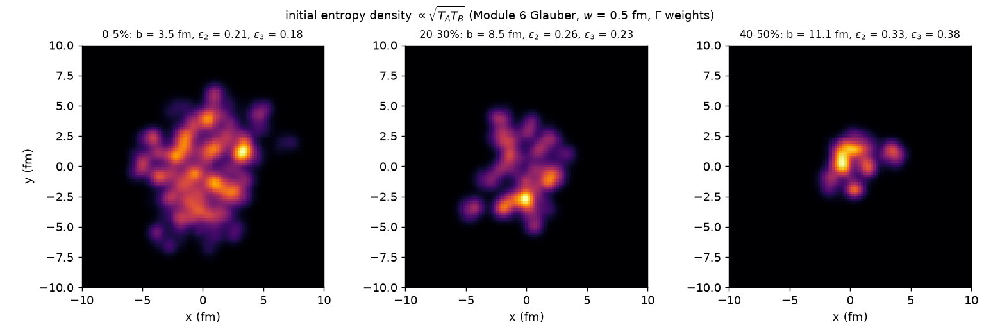
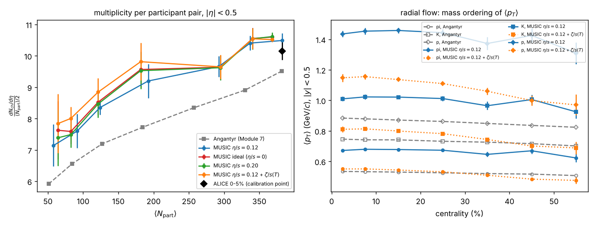
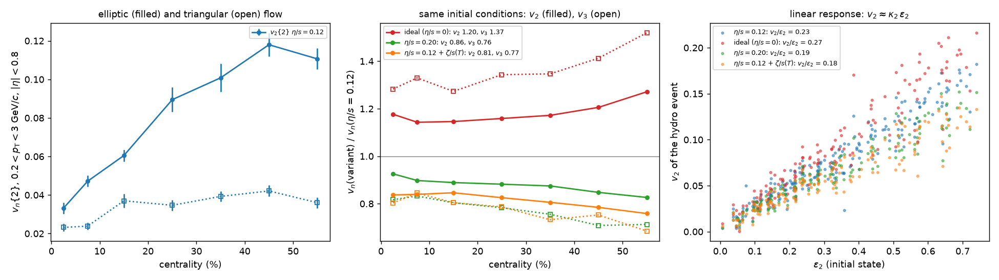
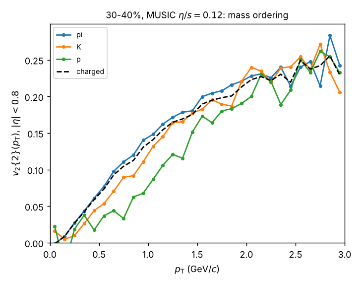

# Module 10 — 점성 유체역학: MUSIC으로 Pb–Pb의 집단 흐름

상태(2026-11-22): **완료 (모형) — WSL2 정식** (nominal 구간당 30, 변형 20 유체 사건) — Glauber 초기 조건 → MUSIC(2+1D 점성 유체) → iSS(Cooper–Frye + 공명 붕괴)
사슬이 돌고, 매개변수 하나(s_factor)를 0–5 % dN_ch/dη에 맞춘 뒤 다중도·⟨pT⟩·v₂·v₃를 **예측**한다.
재현: `bash scripts/run_all_pythia.sh m10` (16코어 ~3시간; 중단되면 `M10_RESUME=1`로 이어서).
남은 것: ALICE 측정(HEPData; 클라우드에서 hepdata.net 접속 불가)과의 직접 비교, JETSCAPE/JEWEL(§5).

---

## 0. 이 모듈이 답하는 질문

> Module 7의 Angantyr는 Pb–Pb를 핵자–핵자 충돌의 합으로 만든다: 다중도는 맞지만 **양성자 ⟨pT⟩가 중심도에 따라
> 거의 변하지 않고(0.88 → 0.82 GeV/c), 타원 흐름 v₂가 없다.** 측정에서는 둘 다 크다.
> 충돌 직후의 뜨거운 물질을 **점성 유체**로 보고 압력 기울기가 그것을 밀어내게 하면, 이 두 가지가 나오는가?
> 그리고 유체의 점성 η/s는 무엇을 바꾸는가?

## 1. 사슬 — `analysis/m10_hydro.py`

1. **초기 조건** (Module 6의 Glauber 그대로): 상처 입은 핵자마다 폭 w = 0.5 fm의 가우스, 가중치 γ ~ Gamma(k = 1.6, 평균 1)
   (핵자–핵자 다중도 요동). 두 핵의 두께 T_A, T_B의 기하평균으로 τ₀ = 0.6 fm/c의 엔트로피 밀도
   s(x, y) = s_factor · √(T_A T_B) — TRENTo의 p = 0 (Moreland, Bernhard, Bass, arXiv:1412.4708). 유체는 정지 상태에서 출발
   (pre-equilibrium 흐름 없음). 격자 30 × 30 fm, 0.2 fm 간격.
2. **중심도**: 최소 바이어스 Glauber 4000 사건의 총 초기 엔트로피 ∫s (모형의 다중도) 백분위 — 실험이 측정한 다중도로 나누듯.
3. **MUSIC** ([github.com/MUSIC-fluid/MUSIC](https://github.com/MUSIC-fluid/MUSIC), GPL-2.0;
   Schenke, Jeon, Gale arXiv:1004.1408, 1009.3244; Paquet et al. arXiv:1509.06738): 2차 점성 유체역학 (Israel–Stewart형),
   2+1D boost-invariant, 상태 방정식은 격자 QCD(hotQCD) + 강입자 공명 기체 (EOS_to_use 9). 시간 간격 0.02 fm/c.
   에너지 밀도 e_sw = 0.18 GeV/fm³(T ≈ 145 MeV)인 얼어붙는 면을 Cornelius로 찾는다.
4. **iSS** ([github.com/chunshen1987/iSS](https://github.com/chunshen1987/iSS), MIT): 그 면에서 Cooper–Frye로 강입자를 뽑고
   (점성 보정 δf 포함), 공명을 붕괴시킨다. **강입자 재산란(UrQMD/SMASH)은 없다** — 강입자는 e_sw에서 상호작용을 멈춘다.
   유체 사건 하나를 M번 독립으로 뽑는다(oversampling; 중심 100번, 주변은 다중도에 반비례해 최대 800번).
5. **보정**: 매개변수 하나, s_factor만 0–5 % dN_ch/dη(|η| < 0.5) = 1943 ± 54 (ALICE, arXiv:1512.06104)에 맞춘다.
   다중도 ∝ 엔트로피 ∝ s_factor라 선형 갱신 두 번이면 1 % 안에 든다. **나머지는 모두 예측**: 다중도의 중심도 의존,
   π/K/p 스펙트럼과 ⟨pT⟩, v₂, v₃.

두 외부 코드는 `scripts/m10_build_hydro.sh`가 **고정된 커밋**으로 `external/`(git에 넣지 않음)에 받아 빌드하고,
커밋 해시를 모든 결과 파일(`results/tables/m10/m10_<variant>.json`의 `codes`)에 적는다.

### 흐름 계수를 재는 법
v_n은 강입자 방위각 분포의 푸리에 계수: dN/dφ ∝ 1 + 2 Σ v_n cos n(φ − Ψ_n). 실험은 두 입자 상관으로 잰다
(v_n{2}² = ⟨cos n(φ₁ − φ₂)⟩). 그런데 같은 사건의 두 입자는 흐름이 아닌 이유(공명 붕괴, 제트)로도 상관된다(non-flow);
실험은 |Δη| > 1 간격으로 줄인다. 여기서는 더 깨끗한 방법이 있다: **같은 유체 사건의 서로 다른 표본**에서 온 두 입자는
흐름만 공유한다. 표본 k의 Q_k = Σ_j e^{inφ_j}이면
  v_n²(사건) = (|Σ_k Q_k|² − Σ_k |Q_k|²) / ((Σ N_k)² − Σ N_k²),
중심도 구간 값은 쌍의 수로 가중한 평균의 제곱근 (실험의 v_n{2}와 같은 정의). 기준 입자: 하전, 0.2 < pT < 3 GeV/c, |η| < 0.8 (ALICE와 같음).
테스트(`tests/test_m10_hydro.py`)가 알려진 v₂ = 0.08, v₃ = 0.05의 toy 표본에서 1/√N 통계 안에서 되찾음을 확인.

## 2. 결과 (WSL2, 16코어: nominal 구간당 30, 변형 20 유체 사건)

`bash scripts/run_all_pythia.sh m10`, 약 3시간 (nominal 58분, 변형 36–44분 + 보정). Glauber 4000 사건 → σ_inel 7.79 b
(Module 6의 7.64 b와 통계 안에서 같음). 변형은 nominal과 **같은** 초기 조건(각 구간의 처음 20개)을 쓴다.
그림 `results/figures/m10/`, 표 `results/tables/m10/m10_<variant>.json`, 같은 사건끼리의 비 `m10_paired.json`,
사건별 기록 `m10_events_<variant>.jsonl`. (클라우드 1차 — 구간당 3–6 사건 — 의 결론과 같고, 숫자는 아래가 정식.)



### 2a. 보정 — 점성이 만드는 엔트로피

| 변형 | η/s | ζ/s | s_factor (0–5 % 처음 8 사건의 dN_ch/dη = 1943) | 이상 유체 대비 |
|---|---|---|---|---|
| ideal | 0 | 0 | 171.2 | 1 |
| nominal | 0.12 | 0 | 156.1 | 0.912 |
| etas020 | 0.20 | 0 | 149.9 | 0.876 |
| bulk | 0.12 | ζ/s(T), 정점 0.13 at 160 MeV (MUSIC 매개변수화 8, arXiv:2005.14682) | 137.6 | 0.804 |

같은 최종 다중도를 내는 데 필요한 **초기** 엔트로피가 이상 유체보다 9 % (η/s = 0.12), 12 % (0.20), 20 % (+ bulk) 적다 —
점성 흐름이 엔트로피를 만든다 (이상 유체는 엔트로피 보존). 보정점 하나가 매질의 성질에 따라 다른 초기 조건을 고른다:
초기 상태와 수송 계수는 **함께** 정해야 한다 (Bayesian 분석들이 둘을 동시에 맞추는 이유).

**보정의 통계**: 클라우드(처음 4 사건)는 s_factor 167, WSL2(처음 8 사건)는 156.1 — 7 % 차이. 0–5 % 안에서도 사건마다
초기 엔트로피가 다르기 때문 (보정 사건 수의 통계). 30 사건 전체의 0–5 % dN_ch/dη는 1967 (ALICE 1943 ± 54의 +1.2 %, 오차 안).
변형 사이의 비는 모두 같은 8 사건으로 보정했으므로 이 요동에 둔감하다.

### 2b. nominal (η/s = 0.12, ζ = 0), 구간마다 30 사건

| 구간 | ⟨N_part⟩ | dN_ch/dη | dN_ch/dη / (N_part/2) | ⟨pT⟩ π / K / p (GeV/c) | ε₂ rms | v₂{2} | v₂/ε₂ | ε₃ rms | v₃{2} |
|---|---|---|---|---|---|---|---|---|---|
| 0–5 % | 387 | 1967 | 10.2 | 0.664 / 0.997 / 1.419 | 0.121 | 0.033 ± 0.003 | 0.27 | 0.112 | 0.023 ± 0.002 |
| 5–10 % | 331 | 1602 | 9.7 | 0.676 / 1.017 / 1.447 | 0.184 | 0.047 ± 0.003 | 0.26 | 0.126 | 0.024 ± 0.002 |
| 10–20 % | 269 | 1224 | 9.1 | 0.674 / 1.014 / 1.449 | 0.238 | 0.061 ± 0.003 | 0.25 | 0.194 | 0.037 ± 0.004 |
| 20–30 % | 189 | 810 | 8.6 | 0.669 / 1.005 / 1.431 | 0.367 | 0.090 ± 0.006 | 0.24 | 0.202 | 0.035 ± 0.003 |
| 30–40 % | 127 | 513 | 8.1 | 0.652 / 0.975 / 1.389 | 0.447 | 0.101 ± 0.007 | 0.23 | 0.282 | 0.039 ± 0.003 |
| 40–50 % | 88 | 341 | 7.8 | 0.654 / 0.980 / 1.396 | 0.516 | 0.118 ± 0.006 | 0.23 | 0.311 | 0.042 ± 0.003 |
| 50–60 % | 57 | 194 | 6.8 | 0.626 / 0.932 / 1.322 | 0.530 | 0.111 ± 0.006 | 0.21 | 0.338 | 0.036 ± 0.003 |

(오차: 유체 사건에 대한 bootstrap. K/π 0.186, p/π 0.051 — 모든 구간에서 같음. 같은 구간 Angantyr(Module 7):
⟨pT⟩ π/K/p = 0.534 / 0.746 / 0.884, K/π 0.128, p/π 0.062, v₂ 없음.)





### 2c. 수송 계수를 바꾸면 — 같은 초기 조건의 비 (140 사건, 모든 구간)

| 변형 / nominal | v₂{2} | v₃{2} | ⟨pT⟩ π | ⟨pT⟩ K | ⟨pT⟩ p | dN_ch/dη |
|---|---|---|---|---|---|---|
| ideal (η/s = 0) | 1.198 | 1.367 | 1.002 | 1.005 | 1.009 | 1.005 |
| η/s = 0.20 | 0.861 | 0.764 | 1.006 | 1.006 | 1.006 | 0.994 |
| η/s = 0.12 + ζ/s(T) | 0.809 | 0.770 | 0.779 | 0.759 | 0.756 | 1.031 |

응답 v₂{2}/ε₂ (rms), 0–5 % → 50–60 % (변형들은 같은 20 사건): ideal 0.32 → 0.26 (−21 %), η/s = 0.12 0.27 → 0.21 (−24 %),
η/s = 0.20 0.26 → 0.17 (−34 %), + bulk 0.23 → 0.15 (−33 %).

### 읽는 법

1. **v₂는 초기 모양의 선형 응답이다.** 사건마다 v₂ ≈ κ₂ ε₂ (그림 오른쪽): 압력 기울기는 짧은 축 방향으로 가파르고, 유체는
   공간의 비대칭을 운동량의 비대칭으로 바꾼다. Angantyr(Module 7)에는 이 변환이 없다 — 같은 Glauber 기하에서도 v₂ = 0.
   v₂{2}는 0–5 %의 0.033에서 40–50 %의 0.118로 ε₂를 따라 오르고, 50–60 %에서 꺾인다 (ε₂는 거의 같은데 v₂가 줄어듦).
2. **응답은 작은 계에서 약하고, 점성이 그 약화를 키운다.** v₂/ε₂가 중심에서 주변으로 줄어든다 — 이상 유체에서도 21 %
   (작은 계는 빨리 얼어붙어 흐름이 다 자라기 전에 멈춘다), η/s = 0.20과 bulk에서는 33–34 % (점성 감쇠는 대략 η/s ÷ 계의 크기).
   주변 충돌의 v₂가 η/s에 가장 민감한 이유.
3. **η/s는 흐름을 줄이고, 높은 조화수일수록 더 줄인다.** η/s 0 → 0.12 → 0.20에서 v₂는 1.20 : 1 : 0.86, v₃는 1.37 : 1 : 0.76.
   감쇠가 대략 n²에 비례해 v₃가 v₂보다 민감하다. 그래서 **v₂와 v₃를 함께 맞추어야** η/s와 초기 조건(ε_n)이 갈린다 — 하나만으로는
   "더 큰 ε₂ + 더 큰 점성"과 구별이 안 된다.
4. **radial flow — 질량 순서.** 같은 유체 속도 장에 실린 입자는 무거울수록 운동량이 크다: 0–5 % ⟨pT⟩ π 0.66 → p 1.42 GeV/c
   (Angantyr 0.53 → 0.88). v₂(pT)도 질량 순서를 보인다 (30–40 %: 같은 pT에서 v₂_π > v₂_K > v₂_p, 2 GeV/c 근처에서 모임) —
   같은 방사 흐름이 무거운 입자를 높은 pT로 밀어낸 결과. 둘 다 측정에 있고 Angantyr에는 없다.
5. **bulk 점성은 ⟨pT⟩를 22–24 % 낮추고 중심도 의존을 만든다.** ζ/s는 팽창에 저항해 방사 흐름을 줄인다
   (0–5 %: π 0.66 → 0.54, p 1.42 → 1.13 GeV/c); 전단 점성은 ⟨pT⟩를 1 % 안에서만 바꾼다. bulk가 있으면 ⟨pT⟩가 주변으로 갈수록
   크게 줄어든다 (p: 1.13 → 0.94, −17 %; bulk 없이 1.42 → 1.32, −7 %). 즉 **⟨pT⟩는 ζ/s를, v_n은 η/s를** 주로 잰다.
   전단 점성만 있는 유체의 ⟨pT⟩가 측정보다 큰 것은 알려진 문제이고 bulk 점성이 그 해법으로 도입되었다
   (Ryu et al., PRL 115 132301 (2015), arXiv:1502.01675 — MUSIC 매개변수화 1의 출처) — 여기서 그 효과를 직접 본다.
6. **bulk는 다중도의 중심도 의존도 바꾼다.** 0–5 %에 맞춘 뒤, 같은 사건에서 bulk는 이상 유체보다 50–60 % 다중도가 5.6 % 크다
   (0–5 %: 1.000, 30–40 %: 1.03) — 빨리 팽창하는 작은 계에서 bulk가 엔트로피를 상대적으로 더 만든다. dN_ch/dη/(N_part/2)의
   모양(nominal: 10.2 → 6.8)을 측정과 맞대면 ζ/s에 대한 또 하나의 제약.
7. **입자 비는 유체가 정하지 않는다.** K/π 0.186, p/π 0.051이 전단 점성 변형·구간에 관계없이 같다 (bulk에서는 δf 때문에
   p/π 0.055 → 0.060으로 주변에서 오름) — 비율은 얼어붙는 온도(e_sw = 0.18 GeV/fm³, T ≈ 145 MeV)의 열적 비.
   Angantyr(K/π 0.128)와 측정의 비교는 HEPData 표를 받은 뒤. 강입자 재산란이 없으므로 p p̄ 소멸 등은 빠져 있다.

**이 모듈에 없는 것**: 강입자 재산란(UrQMD/SMASH; 특히 양성자 ⟨pT⟩와 p/π를 바꾼다), pre-equilibrium 흐름(τ₀ = 0.6 fm/c에서
정지), 3+1D(종 방향 구조, 감쇠 상관), 측정과의 직접 비교. v_n의 통계 오차는 구간마다 5–10 % — 변형 비교는 같은 초기 조건의
비로 한다 (§2c, 사건 사이의 기하 요동이 상쇄됨).

## 3. 데이터 비교 (대기)

클라우드에서 hepdata.net 접속 불가. 받을 표 (ALICE Pb–Pb 5.02 TeV; HEPData에서 arXiv 번호로 검색):
- 하전입자 v₂{2, |Δη| > 1}, v₃{2}, 중심도별: arXiv:1602.01119 (PRL 116 132302 (2016)).
- π/K/p 스펙트럼과 ⟨pT⟩, 중심도별: arXiv:1910.07678 (PRC 101 044907 (2020)).
- dN_ch/dη 중심도별: arXiv:1512.06104 (HEPData ins1410589, Table 1 — Module 7에서도 대기 중).
받으면 provenance JSON(sha256)과 함께 `data/raw/`에 두고 같은 그림에 겹친다. 그때 η/s와 ζ/s를 측정으로 고르는 것이 다음 단계.

## 4. 다음
- 강입자 재산란: SMASH (GitHub, GPL) — iSS 출력 → SMASH afterburner.
- pre-equilibrium: free streaming (τ_fs ~ 1 fm/c).
- Module 9의 에너지 손실을 이 유체 위에서 (팽창하는 매질, 시간에 따라 식는 밀도).

## 5. JETSCAPE와 JEWEL — 이번에 하지 않은 것과 이유

- **JEWEL** (jet quenching MC, hepforge): 클라우드에서 jewel.hepforge.org 접속 불가. Module 9의 단순 모형을 대체할 후보.
- **JETSCAPE**: MUSIC, iSS, 제트 에너지 손실(MATTER/LBT), 강입자 재산란을 엮는 틀 — 이 모듈의 사슬을 포함한다. 빌드 요구
  (Pythia8, HDF5, Boost, ROOT 선택)가 커서 별도 단계로 둔다. 이 모듈이 그 안의 유체 부분을 손으로 먼저 이해하는 단계.

## 6. 실행

```bash
bash scripts/m10_build_hydro.sh                                   # MUSIC + iSS (고정 커밋), ~30 s
python analysis/m10_hydro.py scan --n 4000                         # Glauber 중심도
python analysis/m10_hydro.py calibrate --variant nominal --n 8     # s_factor
python analysis/m10_hydro.py run --variant nominal --per-class 30  # 결과는 results/tables/m10/m10_events_nominal.jsonl
python analysis/m10_hydro.py analyze
```
변형: `--variant ideal | etas020 | bulk` (각각 따로 보정). 사건 하나: 0–5 %에서 MUSIC 단일 스레드 ~5분, iSS ~1초.
